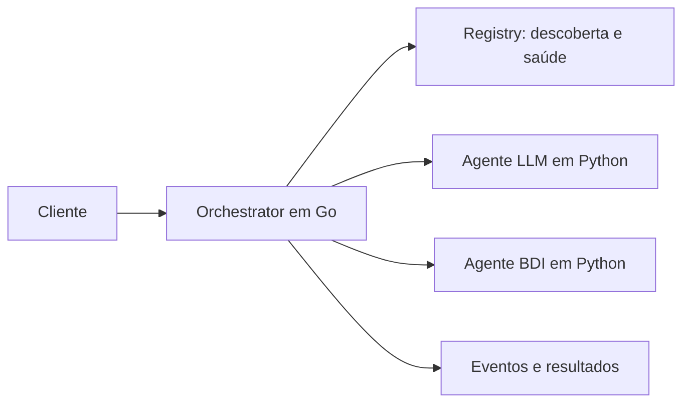

# Ariadne

**Framework para execução e cooperação de agentes heterogêneos.**

Desenvolvido como implementação de referência de um trabalho de graduação sobre
**interoperabilidade entre agentes inteligentes**, Ariadne define um contrato
comum para que agentes com arquiteturas diferentes sejam descobertos, recebam
tarefas, troquem mensagens e cooperem em workflows.

O runtime em Go coordena a execução e trata falhas. Os agentes Python mantêm
sua lógica de domínio: um agente LLM pode interpretar uma solicitação e um
agente BDI pode escolher um plano a partir de crenças e restrições.



A comunicação usa gRPC e Protocol Buffers. O contrato `contract.v1` está na
versão `2.0.0`; os stubs Go e Python estão incluídos no repositório.

## Escolha seu caminho

| Quero… | Comece aqui |
|---|---|
| Declarar agentes e cenário em um arquivo | [Experimentos declarativos](docs/experiments.md) |
| Rodar o primeiro cenário | [Primeira execução](docs/quickstart.md) |
| Entender como funciona | [Arquitetura e conceitos](docs/architecture.md) |
| Explorar cooperação, falhas e mensagens | [Catálogo de cenários](docs/scenarios.md) |
| Desenvolver ou estender o projeto | [Guia de desenvolvimento](docs/development.md) |
| Avaliar o trabalho de graduação | [Guia de avaliação e evidências](docs/evaluation.md) |
| Apresentar o projeto ou explorar resultados | [Roteiro de apresentação](docs/presentation.md) e [visualizador local](tools/inspector/README.md) |

## Primeira experiência

Há uma única forma de executar: `./ariadne run` sobe cada serviço Go e cada
agente declarado em um contêiner Docker, aplica o cenário e remove tudo ao
final. Requer **Docker com Compose v2 e uv**; não exige Go nem chave de LLM:

```sh
./ariadne doctor --file studies/scenarios/basic_task/scenario.py
./ariadne run studies/scenarios/basic_task/scenario.py
./ariadne status
```

Siga o [guia de primeira execução](docs/quickstart.md) para preparar o ambiente
e reconhecer a resposta esperada. Depois, explore
[workflows e recuperação](docs/experiments.md), [BDI declarativo](docs/bdi.md),
as missões de [rotas](studies/scenarios/routing/README.md) e
[fan-out](studies/scenarios/fanout/README.md) e o
[estudo logístico](studies/scenarios/logistics/README.md). `make viewer` abre o
Mission Viewer com as missões gravadas; `./ariadne inspect` abre o Inspector.

## O que está implementado

- Registro e descoberta por capacidade, heartbeat e detecção de falhas.
- Seleção de agentes, timeout por tentativa, retry e reassignment.
- Workflows com dependências, bindings de resultados, paralelismo e API assíncrona.
- Mensageria em memória entre agentes.
- SDK Python com `Agent`, `BdiAgent`, `LlmAgent` e `Scenario`.
- Laço de missão (contrato 2.0.0): um planejador decide os passos de cada rodada.
- Cenários organizados por assunto, com campanhas e análises próprias.

É um protótipo de pesquisa para experimentos locais. Estado em memória,
mensageria sem reentrega e dependência do provedor LLM são limites relevantes;
veja [escopo e limitações](docs/limitations.md).

## Navegação

O [índice da documentação pública](docs/README.md) organiza os guias e a
referência técnica. O [mapa do código](docs/development.md#mapa-do-repositório)
indica os pontos de entrada da implementação. A licença é [Apache 2.0](LICENSE).

## Organização e verificação

O núcleo está em `proto/`, `runtime/` e `sdk/`. [`studies/`](studies/README.md) reúne todos os cenários, seus agentes e avaliações; `tools/` contém o suporte
operacional. Campanhas e proveniência estão em [experimentos](docs/experiments.md).

`make verify` executa as verificações de Go, Python, integração e ferramentas,
sem chamadas LLM reais. A mesma rotina é executada pelo CI.
